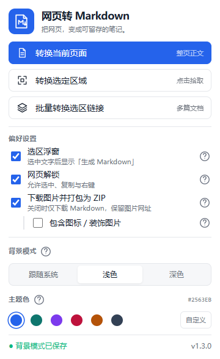
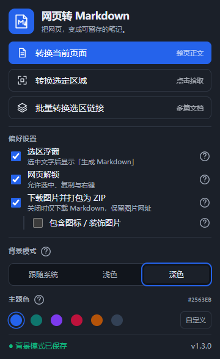

# 网页转 Markdown

把网页正文、选中内容和多篇文档保存为 Markdown 的 Chrome / Edge 扩展。支持图片打包、网页选区解锁，以及可自定义的简约界面。

当前版本：**1.3.0** · Manifest V3 · 无需 API Key

## 界面预览

<p>
  
  
</p>

## 功能

- **整页转换**：提取网页正文，保留标题、段落、列表、表格、代码和图片等 Markdown 结构。
- **区域转换**：点击页面元素，提取指定区域；也可选中文字后点击附近的「生成 Markdown」浮窗。
- **批量转换**：框选区域收集链接，逐项勾选后批量转换，分别保存或合并为一个文件。
- **目录展开**：收集同域、严格位于所选目录路径下的一层子链接，最多 100 个；展开后返回清单，由用户勾选。
- **图片打包**：把 Markdown 和远程图片保存为 ZIP，图片链接改写为压缩包内的相对路径。
- **网页解锁**：解除常见的文字选中、复制和右键限制，兼容部分 Articulate Storyline 课件。
- **个性化外观**：六种预设主题色、自定义颜色，以及浅色、深色、跟随系统三种背景模式。
- **本地保存设置**：主题和各项持久化偏好保存在本机扩展存储中，重新打开浏览器后继续使用。

当前版本不包含翻译功能，选区浮窗只有「生成 Markdown」。

## 安装

1. 下载本仓库 ZIP 并解压，或克隆仓库：

   ```sh
   git clone https://github.com/aaroncheungzy/auto_html_to_md.git
   ```

2. 打开扩展管理页：Chrome 使用 `chrome://extensions`，Edge 使用 `edge://extensions`。
3. 开启「开发者模式」，点击「加载已解压的扩展程序」。
4. 选择包含 `manifest.json` 的项目根目录，再将扩展固定到工具栏。

安装使用不需要构建，也不需要安装 Node.js；Node.js 仅用于开发检查和测试。

### 更新已安装的扩展

更新项目文件后，在扩展管理页点击「重新加载」，然后刷新已打开的网页。旧页面中的内容脚本需要刷新才能替换；如果仍看到旧版翻译按钮，请检查加载目录并完成这两步。

## 使用

### 当前页面与指定区域

- 点击扩展图标 →「转换当前页面」：提取整页正文。
- 点击扩展图标 →「转换选定区域」：进入元素拾取模式，点击目标区域；按 Esc 或右键取消。
- 直接选中正文 →「生成 Markdown」：使用选区快照转换。
- 右键菜单也提供页面转换、选区转换和批量转换入口。

转换结果通常在预览页打开，可切换源码与渲染视图，并复制或下载。

| 快捷键 | 操作 |
| --- | --- |
| `Alt+Shift+M` | 转换当前页面 |
| `Alt+Shift+S` | 转换当前文字选区 |

快捷键也可在浏览器的扩展快捷键设置中修改。

### 批量转换

1. 点击扩展图标 →「批量转换选区链接」。
2. 在网页上点击包含链接的区域，可连续拾取；按 Esc 或右键完成。
3. 扩展打开批量页并预填链接，勾选需要转换的条目。
4. 如需补充链接，点击「框选区域拾取」；如需展开目录，点击「展开已选目录」。
5. 选择分别下载或合并，设置来源信息、图片保留和自动下载选项。
6. 点击「开始批量转换」，查看每条链接的进度和结果。
7. 完成后下载结果；合并模式还支持预览和复制。

也可以先选中含链接的正文，再通过右键菜单直接进入批量页。

### 图片与 ZIP

「下载图片并打包为 ZIP」默认开启，可在弹窗或批量页关闭。开启时，下载 ZIP 包含 Markdown 与 `images/` 下的图片，并改写相应链接；获取失败的图片保留原始远程地址。关闭时仅下载 Markdown，图片保留网络链接，不单独下载图片。

其下的「包含图标／装饰图片」默认关闭，仅主开关开启时可操作。关闭主开关会停用子选项但记住之前的选择，重新开启后恢复。这里的装饰图片指没有 `alt` 和 `title` 的图片；即使开启，也不包含 `data:` 内嵌图、CSS 背景图及正文提取时已移除的图片。合并或分别输出时，扩展会在同一批次中对图片去重。

弹窗与批量页的图片设置本地保存并实时同步。设置项旁的问号图标可悬浮或用键盘聚焦查看详细说明，按 Esc 隐藏说明。

## 设置

所有持久化设置使用 `chrome.storage.local` 保存在当前浏览器配置文件中，不依赖云同步。

| 设置 | 默认值 | 说明 |
| --- | --- | --- |
| 选区浮窗 | 开启 | 选中文字后显示「生成 Markdown」，可随时关闭 |
| 网页解锁 | 开启 | 允许常见受限网页选中、复制和使用右键 |
| 下载图片并打包为 ZIP | 开启 | 关闭时仅下载 Markdown，图片保留网络链接 |
| 包含图标／装饰图片 | 关闭 | 下载图片的子选项，关闭主开关时暂不生效 |
| 背景模式 | 跟随系统 | 可固定为浅色或深色 |
| 主题色 | 蓝色 `#2563EB` | 可选蓝色、青绿、紫色、玫红、琥珀、石墨或自定义颜色 |

主题与背景设置即时同步到已打开的扩展弹窗、预览页、批量页和网页选区浮窗。关闭选区浮窗会立即隐藏按钮。网页本身的主题不会被改变。

## 说明与限制

- 浏览器内置页、扩展页和受平台保护的页面不能注入网页脚本。
- 浮窗不处理输入框、文本域或可编辑区域中的选区。
- 网页解锁覆盖常见 CSS 与事件限制，不保证所有网站或课件都能选中；图片、扫描件和 Canvas 文字需要 OCR，本扩展不提供 OCR。
- 批量抓取可能受登录状态、反爬或非 HTML 内容影响，失败会显示在结果列表中。
- 抓取默认携带目标站点 Cookie，以读取用户有权访问的登录内容。
- 动态网页抓取到空壳内容时，扩展会尝试在后台标签页中渲染后转换。
- 相对链接和图片地址会按原网页地址解析；复杂排版在 Markdown 中可能简化。

## 开发

主要结构：

```text
manifest.json              扩展入口、权限、快捷键
background/                转换结果处理、批量编排、下载
content/                   网页解锁、选区浮窗、元素拾取
popup/                     工具栏弹窗与本地偏好设置
preview/                   单次转换预览与下载
batch/                     链接清单、目录展开、批量进度与结果
offscreen/                 离屏 HTML 解析与 Markdown 转换
utils/converter.js         正文提取与 Markdown 转换
utils/selectionFeature.js  选区资格、定位与解锁控制器
utils/theme.js             主题色、背景模式与跨页面同步
utils/imageBundle.js       图片抓取、去重与 ZIP 打包
styles/                    共享界面样式
icons/                     SVG Logo 与 16 / 48 / 128 像素图标
scripts/build-icons.ps1    Windows 图标生成脚本
tests/                     Node.js 回归测试
```

正文识别依次使用 Mozilla Readability、语义元素和评分策略。跨域抓取由后台服务工作者处理，HTML 解析通过 MV3 离屏文档完成。

### 检查与测试

使用支持 `node:test` 的 Node.js：

```sh
node --test tests/*.test.js
node --check background/background.js
node --check content/content.js
node --check popup/popup.js
node --check utils/theme.js
git diff --check
```

Windows 下重新生成 PNG 图标：

```powershell
powershell -NoProfile -ExecutionPolicy Bypass -File scripts/build-icons.ps1
```

界面修改后应重新加载扩展，并验证主题持久化、系统深浅色切换、浮窗开关，以及页面、选区和批量转换。浏览器验证产生的临时配置与截图目录已加入 Git 忽略规则。

## 第三方组件

- [Mozilla Readability](https://github.com/mozilla/readability)：正文提取。
- [Turndown](https://github.com/mixmark-io/turndown)：HTML 转 Markdown。
- [turndown-plugin-gfm](https://github.com/mixmark-io/turndown-plugin-gfm)：表格、任务列表等扩展语法。
- [marked](https://github.com/markedjs/marked)：Markdown 预览。
- [JSZip](https://github.com/Stuk/jszip)：Markdown 与图片压缩打包。
